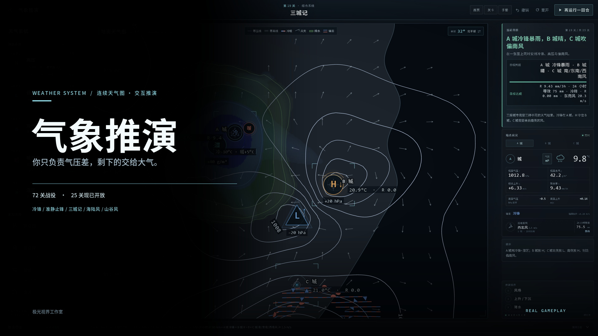
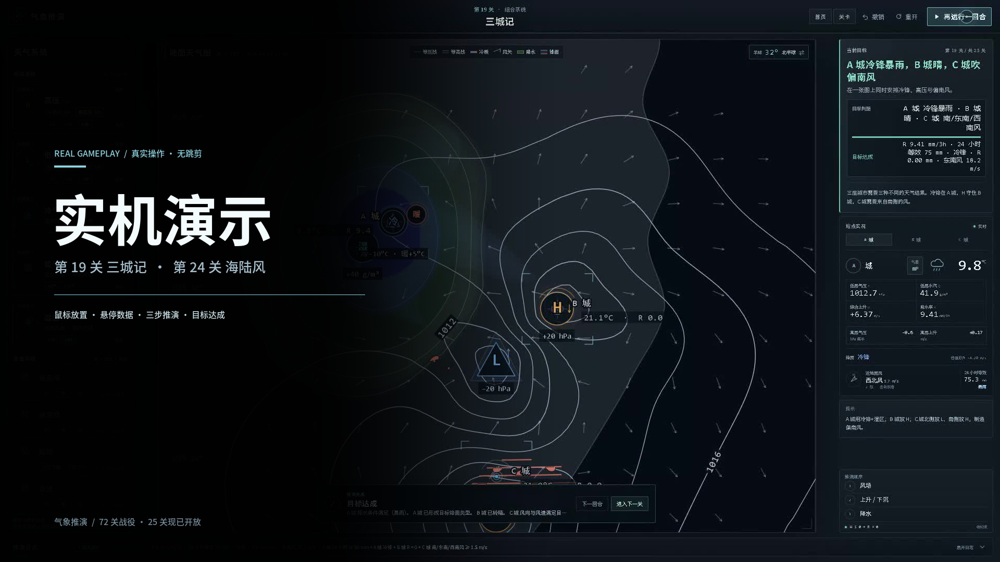
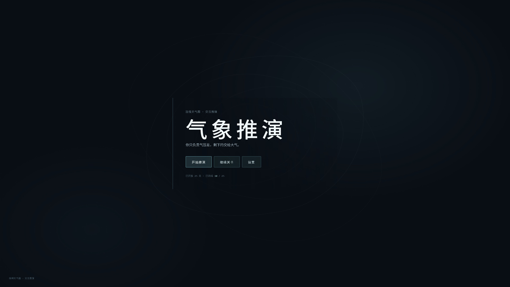
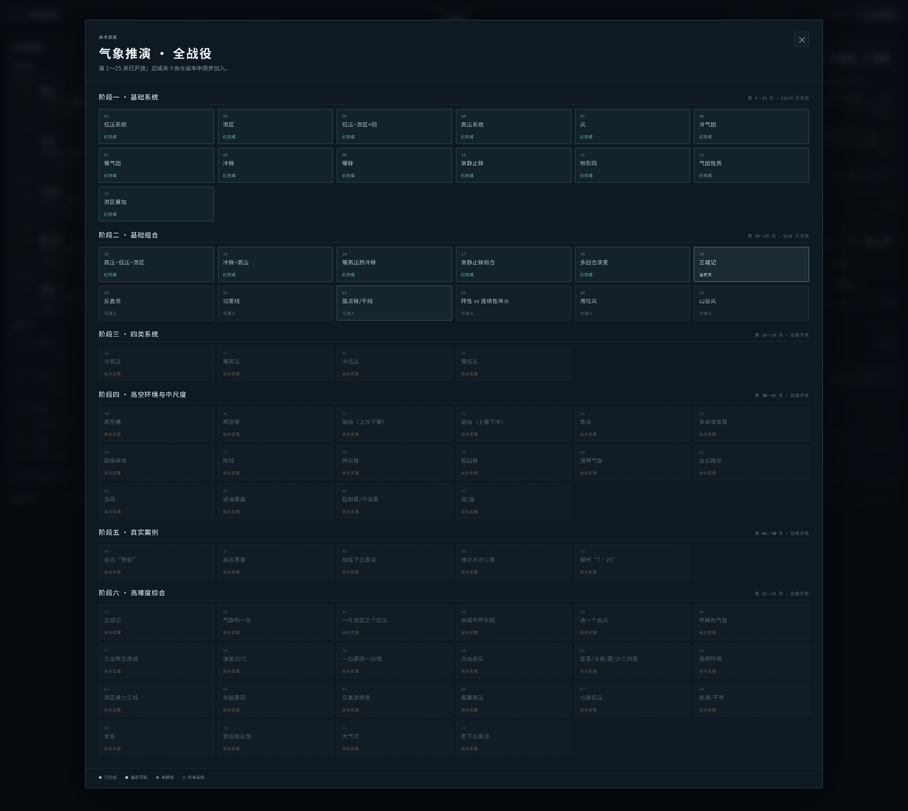
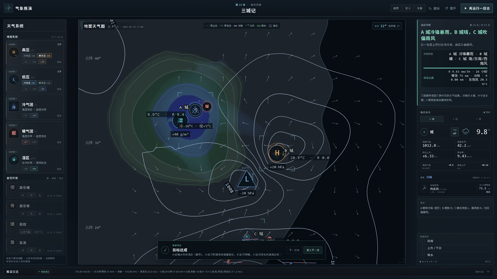
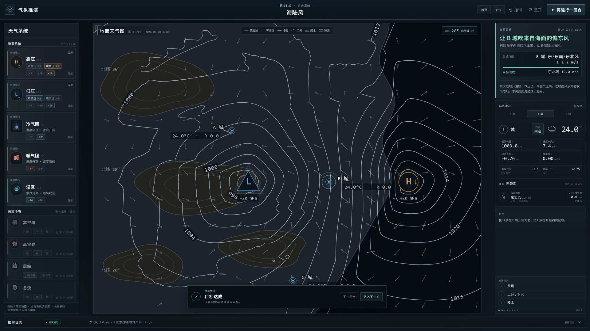
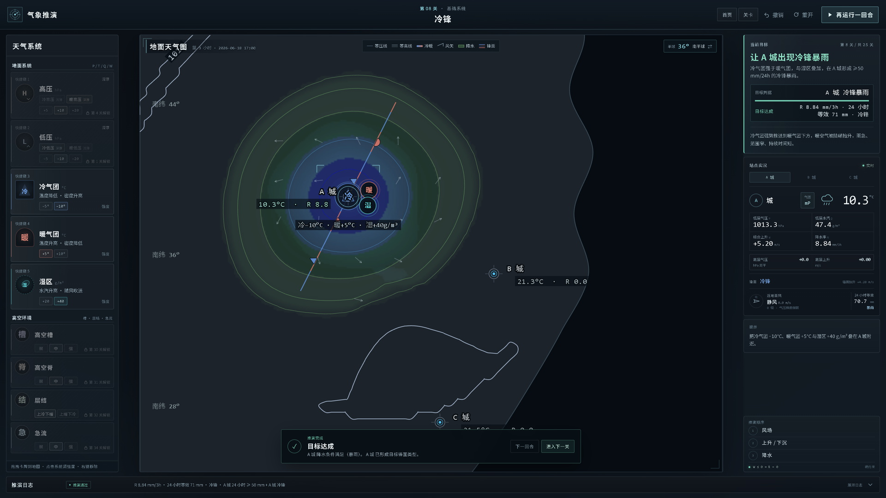
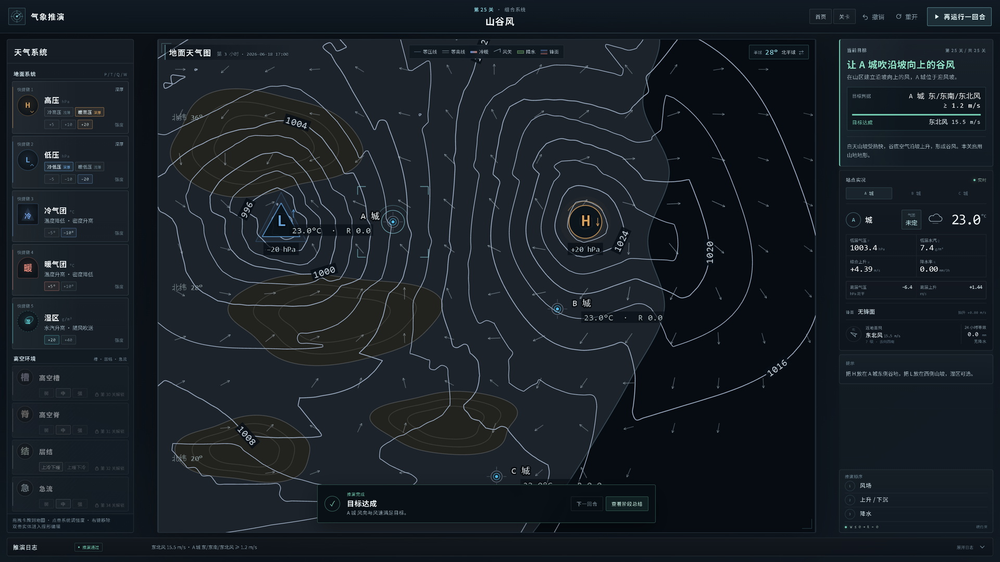

# 气象推演

> 你只负责气压差，剩下的交给大气。

一款关于大气因果的 2D 气象推演解谜游戏。你不直接“画”出雨，而是把高压、低压、冷暖气团与水汽放到连续天气图上，让风、垂直运动与降水自己发生。

**72 关战役 · 25 关现已开放 · 桌面浏览器即开即玩**

[观看宣传片](media/promo-1080p.mp4) · [观看实机演示](media/gameplay-demo-1080p.mp4) · [玩法说明](docs/gameplay.md) · [商店文案](docs/store-copy.md)

## 实机演示

66.5 秒连续实机操作：从首页读取 18/25 存档，进入第 19 关「三城记」，用鼠标放置冷气团、暖气团、湿区与高低压，运行三步推演并达成目标；随后切到第 24 关「海陆风」，让 B 城吹起来自海面的偏东风。

- 真实鼠标轨迹、点击波纹、放置预览与悬停数据
- 风场 → 上升/下沉 → 降水，三步连续结算
- 两个关卡均为游戏内实时计算，目标达成由游戏判定

## 玩法

每一回合只做三件事：

1. **放牌**：把地面天气系统拖到地图上，或点击卡牌再点地图。
2. **调强度 / 范围**：用卡牌上的强度档位，或拖动 H/L 的影响范围。
3. **运行推演**：按“风 → 上升/下沉 → 降水”的顺序结算，检查城市是否达到目标。

| 系统 | 作用 |
|---|---|
| 高压 H | 下沉气流，抑制凝结，常用来让城市转晴 |
| 低压 L | 抽吸、抬升，是降雨的主要动力 |
| 冷气团 | 降低温度、抬高气压；与暖气团相遇可形成冷锋 |
| 暖气团 | 升高温度、降低气压；与冷气团相遇可形成暖锋 |
| 湿区 | 提供水汽；湿区不是雨，必须被抬升并越过饱和阈值才会成雨 |

后续阶段会逐步加入高空槽、高空脊、层结与急流。目标也不止“下雨”：让城市转晴、吹指定方向的风、达到某个温度/气压、连续两回合维持降水，甚至在一张图上同时满足三座城市的不同天气。

完整规则、操作与 25 关列表见 [docs/gameplay.md](docs/gameplay.md)。

## 关卡

- **阶段一 · 基础系统（1–13）**：低压、湿区、低压+湿区=雨、高压、风、冷气团、暖气团、冷锋、暖锋、准静止锋、地形雨、气团性质、湿区叠加。
- **阶段二 · 基础组合（14–25）**：高压+低压+湿区、冷锋+高压、暖高压挡冷锋、准静止锋组合、多回合演变、三城记、反直觉、切变线、露点锋/干线、阵性 vs 连续性降水、海陆风、山谷风。
- **阶段三～六（26–72）**：四类系统、高空环境与中尺度、真实案例、高难度综合；以游戏内实际版本为准。

## 实机截图

全部截图来自真实运行的 Chrome 实机，1920×1080 视口、2× DPR 采集，存档进度为 18/25。

| 首页 | 72 关全战役 |
|---|---|
|  |  |

| 第 19 关 · 三城记 | 第 24 关 · 海陆风 |
|---|---|
|  |  |

| 第 08 关 · 冷锋 | 第 25 关 · 山谷风 |
|---|---|
|  |  |

更多截图、无结算条版本与 4K 原图见 [`screenshots/`](screenshots/)。

## 图标

主图标用高压中心 **H + 等压线 + 冷锋三角** 构成，不依赖文字；已提供 1024 / 512 / 256 / 192 / 180 / 128 / 64 / 48 与 `favicon.ico`。

## 素材清单

| 目录 | 内容 |
|---|---|
| `media/` | 45.6 秒宣传片、66.5 秒实机演示、两张 16:9 封面 |
| `screenshots/` | 首页、72 关总览、5 个代表关、三步推演、索引图、4K 原图 |
| `icons/` | 全尺寸应用图标与 favicon |
| `docs/` | 玩法说明、商店文案 |

## 关于本仓库

本仓库**只发布《气象推演》的宣传与发行素材，不包含游戏源代码、工程文件或可运行构建**。游戏目前为桌面浏览器版本，尚未提供移动端竖屏适配。

## 版权

© 2026 极光视界工作室。宣传片、实机演示、截图、图标与文字仅用于《气象推演》的展示与发行推广，未经书面许可不得复制、修改、再分发或用于商业用途。详见 [COPYRIGHT.md](COPYRIGHT.md)。
